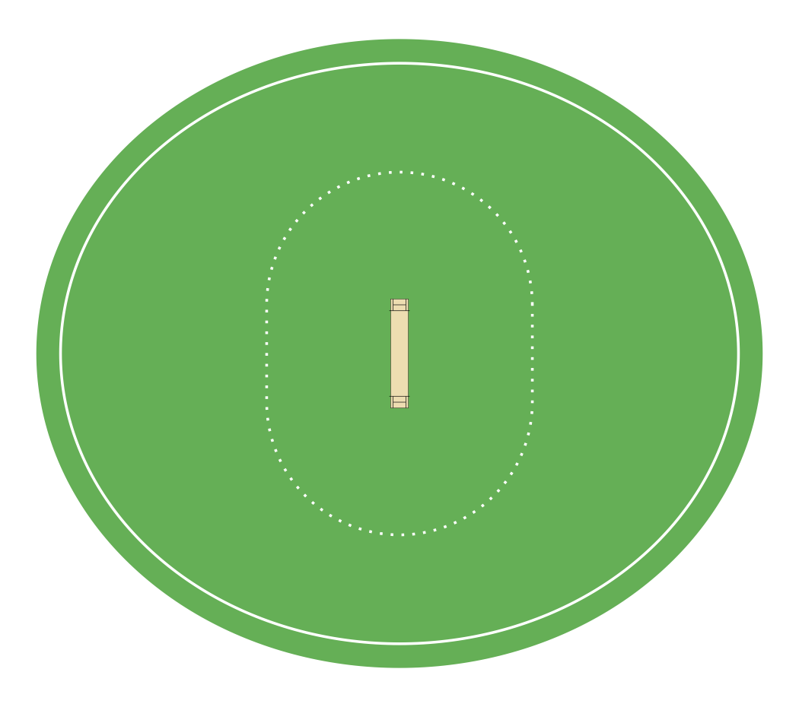

# CricketPlotFunctions
This repository contains a set of functions to plot a cricket field, a cricket pitch and an annotated cricket pitch

## Usage

```r
source("https://raw.githubusercontent.com/CooperDenny/CricketPlotFunctions/main/cricket_plot_functions.R")

cricket_field(straight_boundary = 65, square_boundary = 65)  # boundary distances from the centre of the pitch (m)
cricket_pitch()
cricket_pitch_annotated()                                     # yorker / full / good / short lengths
```

Each function returns a ggplot object, so you can add your own layers (pitch maps, wagon wheels) in metres, with the origin at the centre of the pitch and the pitch running along the y axis. Requires `ggplot2` (3.4.0 or later) only.

## Contents
- `cricket_plot_functions.R`: R script containing functions to plot a cricket field, a cricket pitch and an annotated pitch
- `CricketPlotFunctions.Rproj`: R project file for the CricketPlotFunctions project.
- `README.md`: This file providing an overview of the repository.
- `images`: Folder containing images of the plots that the functions generate

## Example Plots
`cricket_field(straight_boundary = 60, square_boundary = 70)` 


`cricket_field(straight_boundary = 75, square_boundary = 65)` 


`cricket_pitch()`


`cricket_pitch_annotated()`

